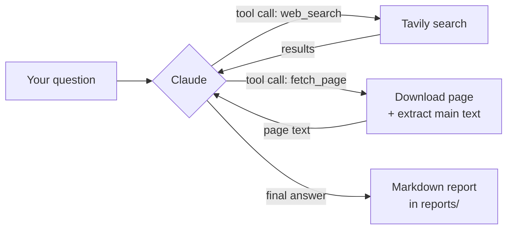

# web-search: a research agent built from scratch

Ask a question in your terminal. The agent searches the web, reads the most useful pages, and writes a Markdown report where every claim points to a numbered source.


It's built directly on the [Anthropic Python SDK](https://github.com/anthropics/anthropic-sdk-python), with no LangChain or other agent framework. The agent loop, the tools, the guardrails and the terminal UI are all written by hand, so every part of how the agent works is visible in about 500 lines of Python.

**Example reports:** [Python vs JavaScript in 2026](examples/python-vs-javascript-2026.md) · [Laravel's latest release](examples/laravel-latest-release.md) · [Best university in 2026](examples/best-university-2026.md)

## Features

- **Real research, not memory.** It searches with [Tavily](https://tavily.com), then reads the actual pages before answering, instead of answering from search snippets or training data.
- **Cited reports.** Every report has the same layout (title, summary, topic sections, sources) and uses numbered citations like `[1]`, which link to the pages that were read.
- **Live terminal output.** You see each search and each page as it happens, and the report streams in while it's being written.
- **Guardrails.** It has a cap on rounds, searches and page reads, skips pages it already read, and recovers when a tool fails.
- **Cost-aware.** Prompt caching is on, and every run ends with a token summary.
- **Tested without the API.** The agent loop is tested with a fake Claude, so the tests are free, fast, and give the same result every time.

## Quick start

You need Python 3.10+, an [Anthropic API key](https://console.anthropic.com/) and a [Tavily API key](https://tavily.com) (the free tier is enough). The agent runs on **your own keys**, and nothing is hosted.

**1. Install the `web-search` command.** With [uv](https://docs.astral.sh/uv/):

```bash
uv tool install git+https://github.com/ace-brown/my-agent
```

Or with pipx: `pipx install git+https://github.com/ace-brown/my-agent`

**2. Add your keys.** Either export them in your shell:

```bash
export ANTHROPIC_API_KEY=sk-ant-...
export TAVILY_API_KEY=tvly-...
```

or put them in a `.env` file in the folder where you run the command (see [`.env.example`](.env.example)).

**3. Ask a question.**

```bash
web-search "What's new in Python 3.14?"
```

The report is saved to `reports/` in the current folder, with a file name based on the time and the question. Run `web-search --help` for usage.

### Running from source

```bash
git clone https://github.com/ace-brown/my-agent.git
cd my-agent
uv sync
cp .env.example .env        # then fill in your keys
uv run web-search "your question"
```

## How it works



At the center is a short loop: send the conversation and the tool definitions to Claude, run any tools it asks for, send the results back, and repeat until Claude gives a final answer (or a limit is reached).

The code keeps the agent separate from the display. The agent never prints. It emits **events** (thinking, tool call, text piece, token usage), and the terminal UI listens to them. The same agent could drive a web UI or a test without changes.

```
src/my_agent/
  main.py     command-line entry point: arguments, API keys, error messages
  agent.py    the agent loop, system prompt and guardrails; emits events
  tools.py    web_search and fetch_page, their JSON schemas, and the tool registry
  events.py   the event types shared by the agent and the UI
  cli.py      renders events in the terminal with rich
  report.py   saves the report as a Markdown file
tests/        pytest tests with a fake Claude and fake tools
```

## Design decisions

- **No framework.** Writing the loop by hand makes tool use concrete: what Claude sends, what the code sends back, and when the loop stops. Everything else (limits, errors, streaming, caching) is engineering around that loop.
- **Clean text, not raw HTML.** [trafilatura](https://github.com/adbar/trafilatura) strips menus, ads and scripts before anything reaches the model. Pages are cut to 10,000 characters, with a note telling Claude the page was truncated.
- **Cite only pages that were read.** A search snippet isn't proof of what a page says, so the system prompt allows citations only for pages fetched with `fetch_page`.
- **The report layout is a template, not a description.** Showing Claude the exact Markdown structure gave much more consistent reports than describing it in words.
- **Prompts shape behavior, code enforces it.** Rules that must always hold, like the search and fetch limits, are enforced in code. When a limit is hit, Claude is told why and asked to write with what it has.
- **Tool failures are information, not crashes.** If a tool raises an error, the error is sent back to Claude as a tool result, so it can try another source. A URL only counts as "already read" after a successful fetch, so a failed page can still be retried.
- **Cut-off answers are flagged.** If Claude hits its output limit, the report starts with a warning instead of passing for a complete report.
- **Prompt caching instead of context trimming.** Each round resends the whole conversation. Caching that repeated prefix makes it about 10× cheaper. A run stays around 20k tokens, so trimming old pages would only hurt the citations and break the cache.
- **Honest User-Agent.** Page requests identify the tool (name, version, link to this repo) instead of pretending to be a browser.
- **Helpful errors.** Missing or rejected API keys and network problems give one clear message instead of a traceback. The API's own retries handle temporary failures.

## Security: web content is untrusted

Every page the agent reads was written by someone else, and a page can contain text written to manipulate the model ("ignore your instructions and…"). This is called **prompt injection**. This project limits the risk by design:

- **Instructions and web content are kept apart.** The research rules live only in the system prompt. Web content only ever reaches Claude as tool results, never as instructions.
- **The tools can only read.** The agent can search and download public pages, and nothing else. It can't run code, write files (except the report, which plain Python saves), or send data anywhere.
- **Output stays text.** Text from the web is escaped before it's shown in the terminal, so it can't inject terminal formatting.

This lowers the risk, but it doesn't remove it. A malicious page can still try to steer what goes into a report, so treat reports as research notes that need checking, not as verified facts.

## Tests

```bash
uv run pytest
```

The tests replace Claude with a fake that returns prepared replies, and replace the search tool with a fake that records what it was asked. They cover saving reports, a direct answer, and a full round where Claude searches first and answers second. No API key and no network are needed.

## Limitations

- Claude sometimes cites a page it only saw in search results, despite the prompt rule. A code check that compares cited URLs with fetched URLs would catch this, but isn't built yet.
- The duplicate-page check compares URLs as plain text, so `example.com/page` and `example.com/page/` count as different pages.
- It uses `claude-haiku-5-5` to keep runs cheap. A larger model writes deeper reports at a higher cost. The model is set in `src/my_agent/agent.py`.
- There's no evaluation set yet, so report quality is checked by reading reports, not by a score.

## Recording the demo

The demo above is an animated SVG, made from a recording of a real run. To record a GIF instead, install [vhs](https://github.com/charmbracelet/vhs) and run `vhs docs/demo.tape`.

## License

[MIT](LICENSE)
